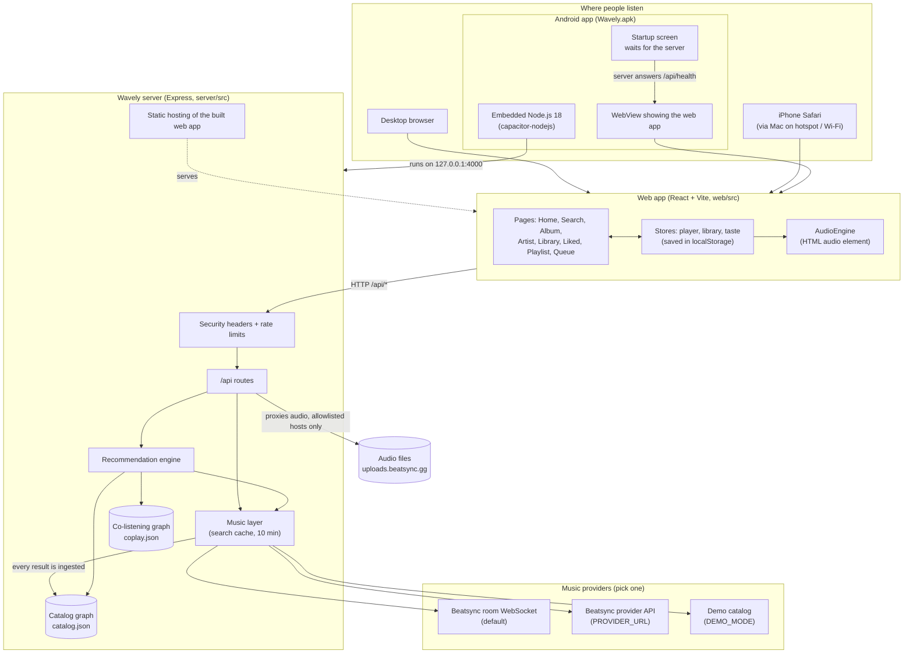
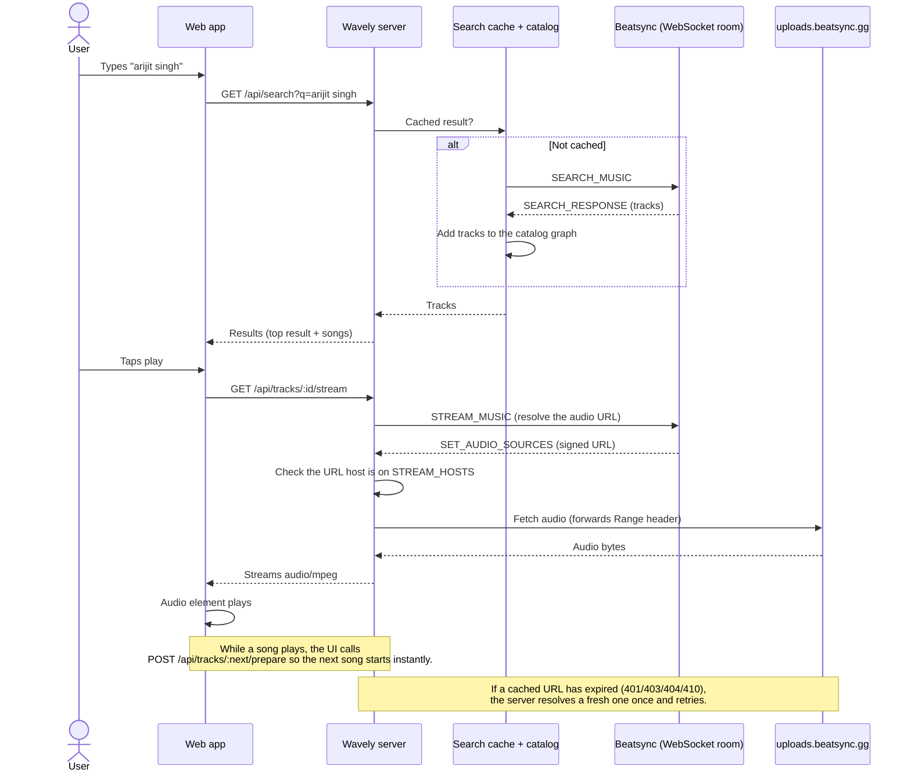
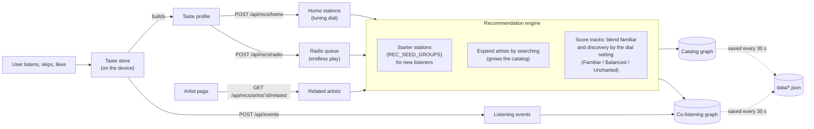
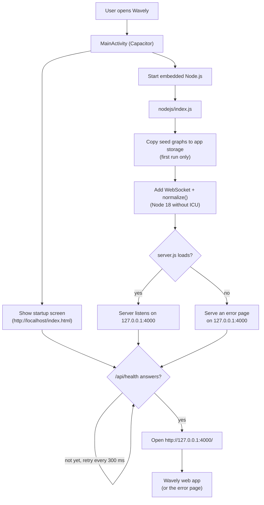

# Wavely platform flowcharts

How Wavely fits together, from the screen down to the music source. The diagrams are
[Mermaid](https://mermaid.js.org): they render on GitHub and in VS Code's Markdown preview
(with a Mermaid extension). To view them in a browser, open `flowchart.html` in this folder.

## 1. System overview

One Node.js server (Express) provides the API and serves the built web app. The same
server runs in three places: on a computer or host, on a Mac shared to other devices, or
inside the Android app.

## 2. Search and play a song

## 3. Recommendations and taste

## 4. Android app startup

